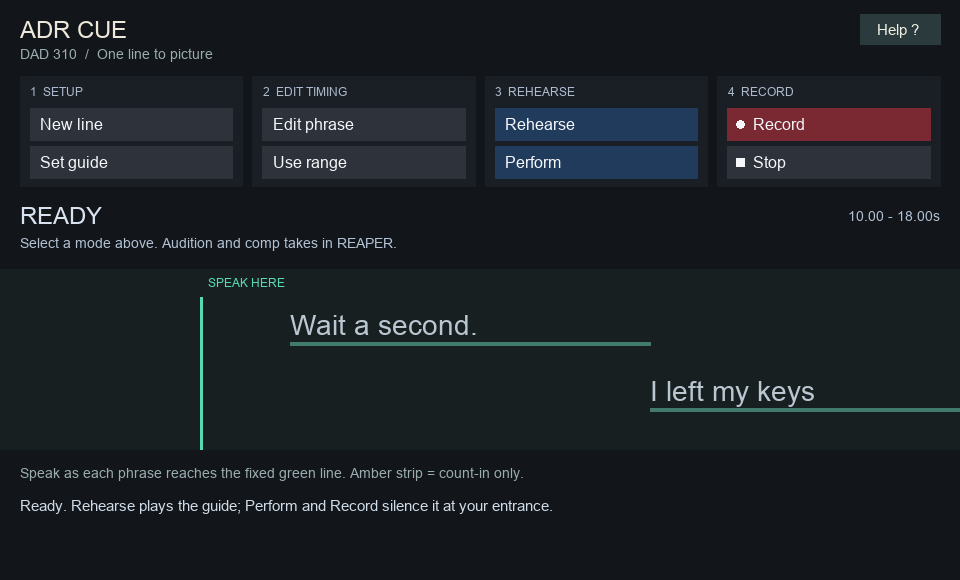

# DAD 310 ADR Cue

Version 0.3.1. Built for DAD 310: Sound Design for Film at Dakota State University.

A REAPER script for replacing one line to picture. It provides scrolling phrase cues, a separate amber three-second count-in strip, three audio beeps, and guide playback control. Everything runs locally.

## Install

[Download ADR Cue v0.3.1](https://github.com/tatecarson/reaper-adr-cue/releases/download/v0.3.1/dad310-adr-cue-v0.3.1.zip). Download the whole ZIP, not an individual Lua file.

1. Extract the entire ZIP into a permanent folder. Keep `DAD310_ADR_Cue.lua`, `adr_core.lua`, and `adr-beep.wav` together.
2. In REAPER 7, open **Actions > Show action list**.
3. Choose **New action > Load ReaScript**, then select `DAD310_ADR_Cue.lua`.
4. Select the new action and click **Run/close**. You can assign it a shortcut or toolbar button.

The script uses features included with REAPER. It does not require SWS, ReaPack, Python, a browser, an account, or an internet connection. It is intended for macOS and Windows; Windows and physical microphone recording still need a classroom-machine check.

## Help inside the tool

Controls are grouped into Setup, Edit timing, Rehearse, and Record. Rest the pointer on a button for 1.2 seconds to see a short hint. Moving or clicking resets the delay. Tooltips stay hidden during playback and recording. Click **Help ?** at the top right for Setup, Recording, and Troubleshooting pages. Click **Close help** or press Escape to return. The `?` key also toggles Help. Opening Help does not stop an active run; Space will stop it. Keep the window at its default size or larger to read all help text.

Neutral controls prepare the cue. Blue controls rehearse it. The red Record button captures audio; the square Stop button ends the run. Labels and icons reinforce color. The larger dialogue area uses a fixed green reading line; amber is reserved for the count-in strip.

## Prepare a line

1. Save your project in its own folder. Import the phone video and open REAPER's video window.
2. Place the video far enough into the project that the dialogue entrance is at least four seconds after project zero. Ten seconds is convenient. Keep the original audio with its picture.
3. Drag a **time selection** covering the line, from the first spoken sound to the end. Turn off beat snapping when matching speech.
4. Click **New line**. Type the dialogue, using `|` between phrases. For example: `Wait a second. | I left my keys | on the table.`
5. The tool creates `ADR PHRASES`, `ADR COUNT-IN`, and `ADR RECORD` tracks. Initial phrases occupy equal portions of the selected range. This is a starting layout, not automatic speech alignment.
6. Select the original dialogue track and click **Set guide**. A video track with its original audio is fine. Use a plain track without sends, hardware outputs, or volume automation. Clear track solos.
7. Listen to the original. Move each phrase item so its left edge matches the phrase's beginning. Trim its right edge to the phrase's end. Leave gaps for breaths. Use short phrases so the scrolling text remains readable. Select a phrase item and click **Edit phrase** to change its words.
8. Put the cue window beside or below the picture. The first word of each phrase crosses the fixed green line at that phrase's start. The underline shows its duration. Words within a phrase are not individually aligned. For finer control, create shorter phrases.

**Use range** changes the overall entrance and end from the current time selection and rebuilds the beeps. It does not move the phrase items. **New line** replaces the cue and phrase items after confirmation; recorded takes remain.

## Rehearse and record

- **Rehearse** plays the original dialogue. Playback starts four seconds before the entrance. Beeps sound at minus three, minus two, and minus one second. Speak on the silent fourth beat.
- **Perform** uses the same count-in, then turns down the guide audio at the entrance. It does not record. The video stays visible.
- **Record** starts a normal REAPER recording with the count-in and guide silencing. First select a microphone input on `ADR RECORD`, arm that track, and disarm all other tracks. Choose **Options > Record mode: normal**. Use headphones and set a sensible input level. Input monitoring starts disabled; enable it only if you need REAPER monitoring rather than your interface's direct monitoring.
- Playback stops one second after the cue ends. **Stop** finishes early. Pressing Space in the cue window toggles rehearsal and Stop. Escape closes the cue window.
- Existing items on `ADR RECORD` are temporarily muted during a run so old performances do not play over the actor. Their previous mute settings return afterward. New recordings remain available for review.
- Click Record again for another performance. REAPER's existing recording-overlap preference determines whether recordings become takes or separate items. Keep the recordings when REAPER prompts you.

For review, use REAPER's normal transport, mute the original guide, and audition and comp performances with fixed item lanes. Review controls are intentionally kept in REAPER; this tool does not rename takes or alter comp selections.

The tool restores the guide level and repeat setting when you stop, close its window, or switch project tabs. Open the action again to work in a different project. Save the project after editing cues. Close the cue tool before mixing or rendering, and verify that `ADR COUNT-IN` is muted.

## Switch to editing

Stop playback and click **Edit in REAPER** at the top of the window.

- Hides only `ADR PHRASES` and `ADR COUNT-IN` from the track panel and mixer.
- Keeps your video/location track visible and leaves its audio unchanged.
- Leaves `ADR RECORD`, your takes, and other tracks unchanged. Count-in beeps remain muted.

For a scene with one replacement line, retain the location sound before and after that line. On a working copy of the location audio, split around the original line and remove or mute only that section. Fit the ADR there, add matching room tone where needed, and use short fades. Keep the untouched original synchronized on a separate safety track. The button does not cut, mute, or otherwise edit the scene for you.

Click **Return to ADR** to restore the cue tracks' previous visibility when you need another take. Mode changes require stopped playback; rehearsal and recording are blocked in Edit mode.

Edit mode persists after closing the tool and saves with your project. Version 0.3.1 also restores guide visibility and volume saved by 0.3.0 if you reopen the tool while its older Edit mode is active.

## Current limits

- One active line per project. Duplicate the project for another line if you want to retain a separate cue setup.
- The count-in strip and dialogue appear in a companion window, not over the video or in an exported movie.
- Drawing and guide silencing follow REAPER's script refresh cycle. They are not sample-accurate, and smoothness depends on system load. Beeps are audio items on the timeline. Project playback rate must be 1.0.
- Use the tool's Record button for automatic guide control. Starting recording from REAPER's own transport does not start an ADR run.
- Keep metronome/count-in options off for this exercise to avoid adding another count-in. Keep phrase and beep tracks in the time timebase when changing tempo.
- Do not change guide routing or edit cue tracks during a run. After an unexpected interruption, reopen the tool to recover temporary guide and take-mute settings before saving or rendering.
- The automated timing and restoration tests use a simulated REAPER environment. Live scrolling, video playback, microphone recording, and hardware latency need an instructor smoke test before student rollout.

## Development

The script and `adr_core.lua` use REAPER's built-in Lua environment. `adr-beep.wav` is a generated 80 ms, 1 kHz tone at approximately -18 dBFS.

Run `tests/Run_ADR_tests.lua` from REAPER's action list, or run it with Lua 5.4 using:

```sh
lua -e 'reaper={MB=function(text) print(text) end}' tests/Run_ADR_tests.lua
```

The tests simulate REAPER transport and track state; they do not replace audio-interface and video-sync testing.

## Interface preview



This preview is rendered from the drawing code with simulated cue data.
